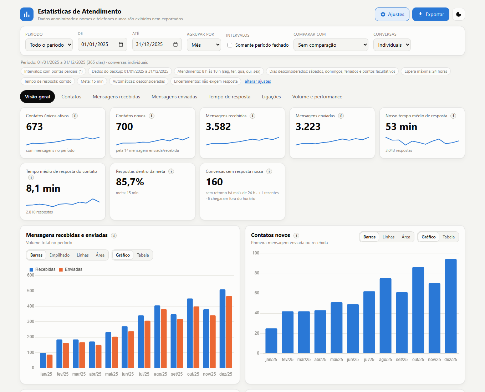

# WhatsApp Portable Statistics

[](https://github.com/aaschenbach/whatsapp-portable-statistics/actions/workflows/ci.yml)
[](LICENSE)
[](https://www.python.org/)
[](https://docs.astral.sh/uv/)
[](#quick-start-english)
[](#language)

An **offline, anonymized statistics dashboard** for **WhatsApp / WhatsApp Business** customer service, built on top of the
output of [**whatsapp-portable-viewer**](https://github.com/aaschenbach/whatsapp-portable-viewer). No server, no internet,
no names, no phone numbers, no message text, and you do **not** need to carry the whole USB stick around: the dashboard
works from a single small file.

> **This project depends on [whatsapp-portable-viewer](https://github.com/aaschenbach/whatsapp-portable-viewer).**
> You first use the viewer to decrypt your own backup and generate its output folder; this project only **reads** that
> folder and never changes anything in it. The viewer is a separate product.



- Unique and **new contacts**, per day / week / month / quarter / semester / year.
- Messages **received and sent**, by media type (text, image, document, audio, video, sticker, other).
- **Response time** both ways (average, median, P90), first reply to new contacts, share within a target (SLA).
- **Calls**: received/made, answered/missed, voice/video, duration, time to return a missed call.
- **Compare with the previous period** (or the same period last year), with a "closed periods only" option.
- Custom periods, dashboard-style charts (bars, stacked, lines, area, donut) and tables for everything.
- **Export to PDF, CSV and XLSX.**
- Business hours, out-of-hours volume, heat map by weekday and hour, weekends and holidays can be ignored.
- Automatic messages (greeting/away) and closing messages ("thanks", "ok", "bye") can be ignored in response times.
- Every number has an **"i"** button with a short explanation and a "Learn more" link to the exact calculation rules.
- Names and phone numbers are **never** shown or exported.

> **The interface and the full guide are in Brazilian Portuguese: [README.pt-BR.md](README.pt-BR.md).**

---

## Quick start (English)

### Step 1 — Generate the viewer output

Follow the [whatsapp-portable-viewer guide](https://github.com/aaschenbach/whatsapp-portable-viewer#quick-start-english)
until you have its output folder (usually `pendrive/`), which contains a `data/` sub-folder.

### Step 2 — Prepare the statistics data

From this project's folder, run one of the scripts and enter the viewer's output folder when asked
(the folder that contains `data`; the `Media` folder is **not** used):

```powershell
# Windows (double-click preparar-dados.bat, or:)
.\preparar-dados.ps1 -Pendrive "D:\pendrive"
```

```bash
# Linux / macOS
bash preparar-dados.sh /path/to/pendrive
```

It needs [`uv`](https://docs.astral.sh/uv/) **or** Python 3.8+ (standard library only). It reads only
`data/chats.js` and `data/chat_*.js` and writes **one file**, `dados/estatisticas.js`, that contains only timestamps,
direction, media type and a few computed flags: **no names, phone numbers or message text**.

### Step 3 — Open the dashboard

Double-click `estatisticas.html`. Any modern browser works, offline. To update, run the viewer and the script again.

To use the dashboard on another computer, copy this folder (a few MB) after running the script. You do not need the USB stick.

---

## Language

The dashboard and its help page are currently in **Brazilian Portuguese only**. The scripts print Portuguese messages.

## Documentation (pt-BR)

0. [Overview](docs/00-visao-geral.md)
1. [Prepare the data](docs/01-preparar-os-dados.md)
2. [Using the dashboard](docs/02-usando-o-painel.md)
3. [Settings and rules](docs/03-ajustes-e-regras.md)
4. [Common problems](docs/04-problemas-comuns.md)
5. [How it works](docs/05-como-funciona.md)

Also: [security and privacy](docs/seguranca-e-privacidade.md) and [credits](docs/creditos.md).

## Demo

The screenshots use a **100% fictional** demo generated by `demo/gerar_demo.py` (no real data). See [demo/README.md](demo/README.md).

## Privacy

`dados/estatisticas.js` has no names, phone numbers or message text, but it does contain **dates and times** of messages
and calls. Think about that before publishing it. Never publish your backup, `msgstore.db`, the `Media` folder or the
viewer output. See [docs/seguranca-e-privacidade.md](docs/seguranca-e-privacidade.md).

## License

[The Unlicense](LICENSE) (public domain). The bundled [Chart.js](https://www.chartjs.org/) is MIT-licensed
([stats/lib/chart.js-LICENSE.md](stats/lib/chart.js-LICENSE.md)). Not affiliated with WhatsApp or Meta.
