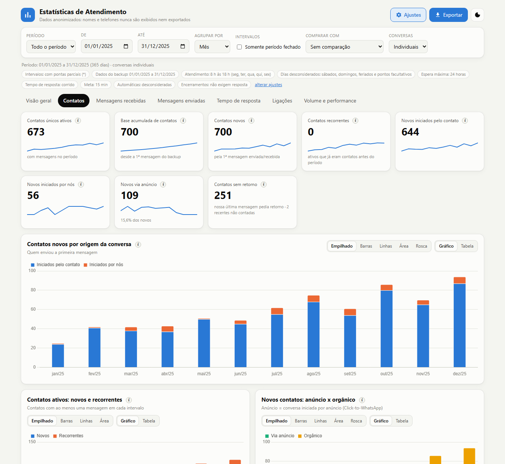
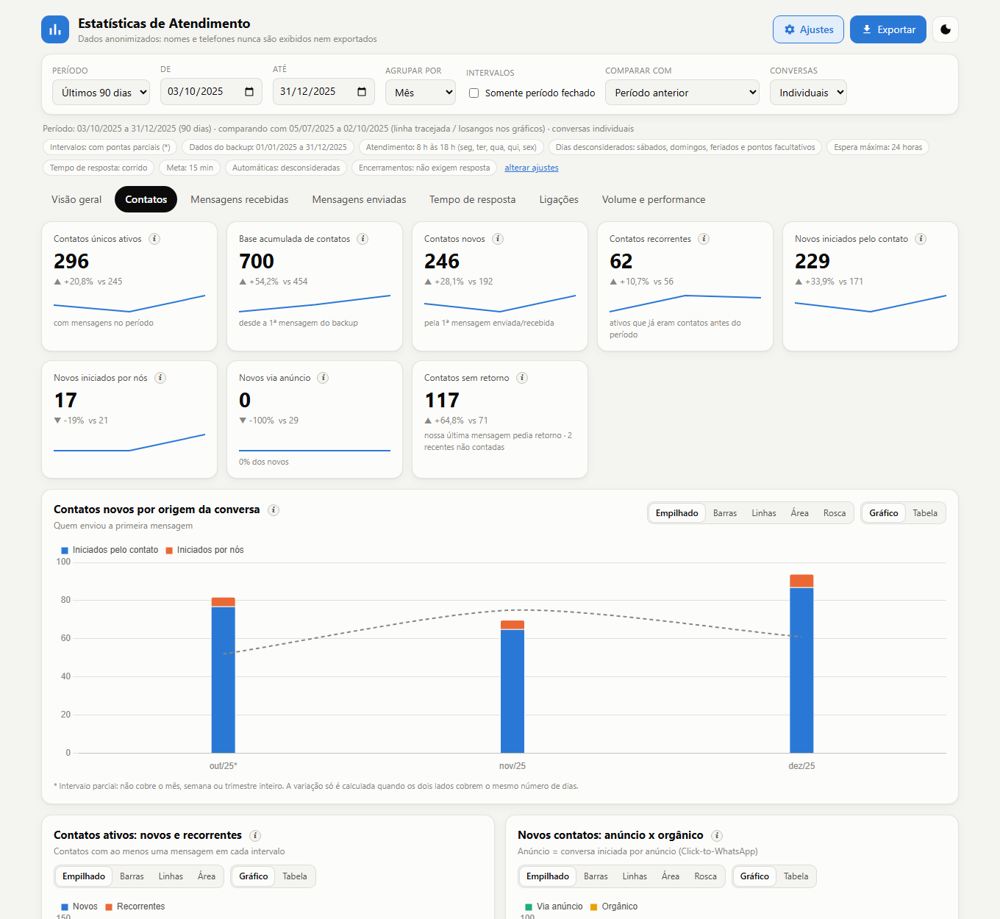
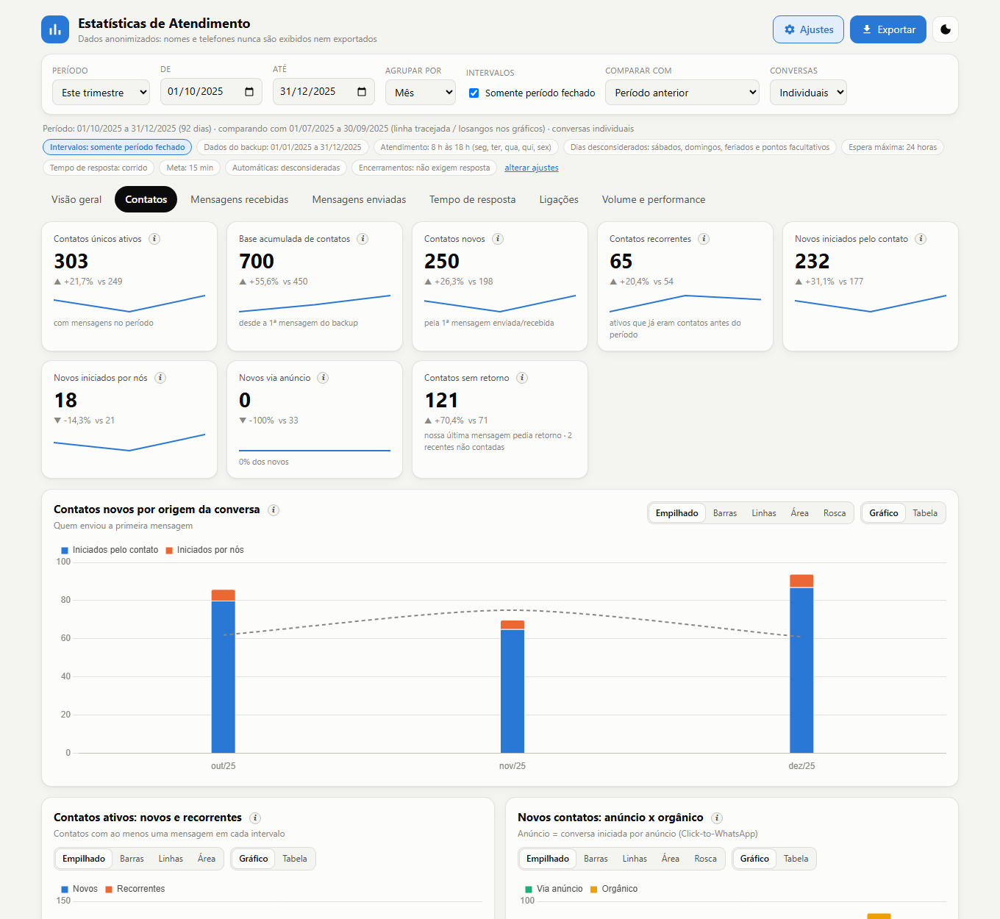
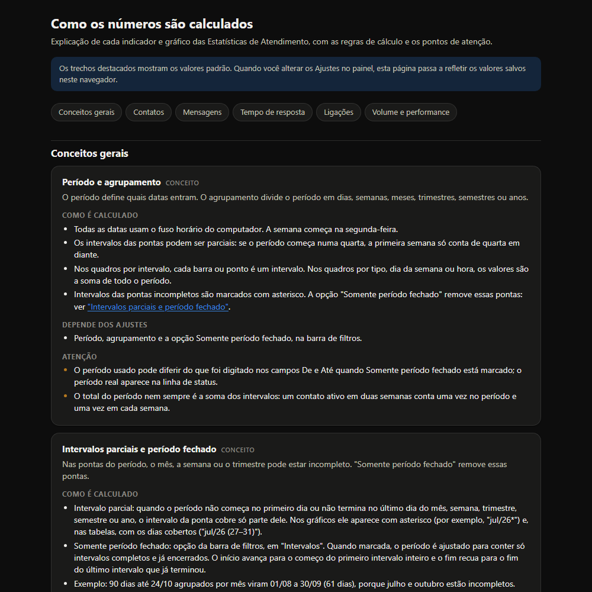
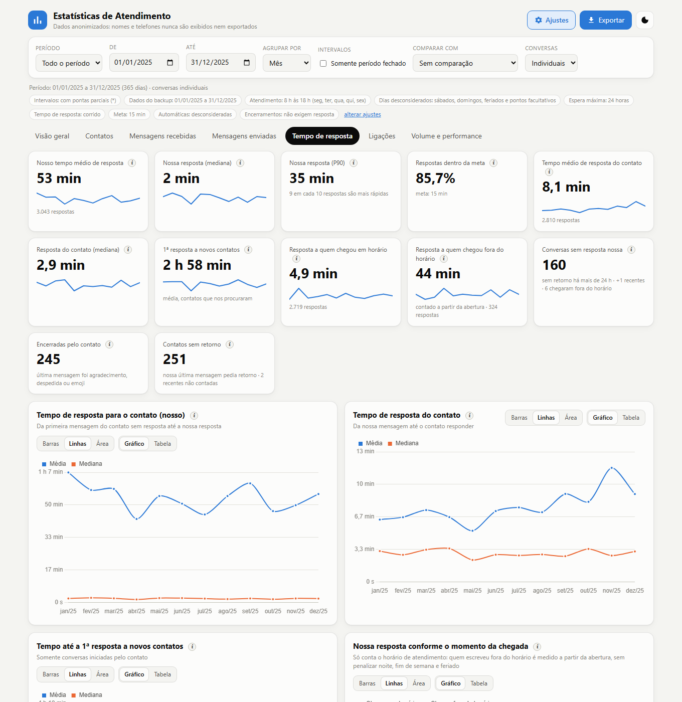
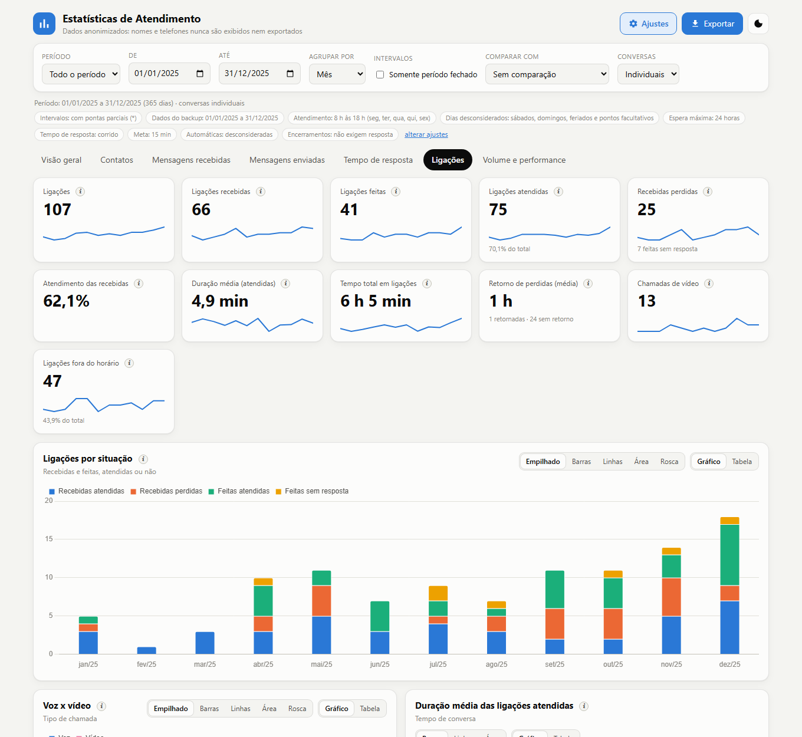
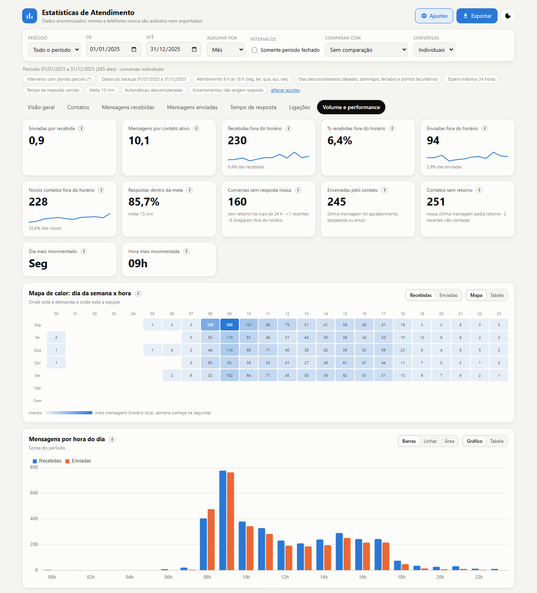

# 2. Usando o painel

> Todas as imagens deste guia vêm de uma **demonstração 100% fictícia** (`demo/`).

## A barra de filtros

| Filtro | O que faz |
|---|---|
| **Período** | atalhos (hoje, 7/30/90 dias, este mês, mês passado, trimestre, semestre, ano, todo o período) ou **personalizado** pelos campos De e Até |
| **Agrupar por** | dia, semana (começa na segunda), mês, trimestre, semestre ou ano |
| **Intervalos: Somente período fechado** | remove as pontas parciais do período (veja abaixo) |
| **Comparar com** | sem comparação (padrão), período anterior ou mesmo período do ano anterior |
| **Conversas** | individuais (padrão), grupos ou todas |

Os botões no topo: **Ajustes** (regras de cálculo) e **Exportar** (PDF, XLSX ou CSV). A linha de status, abaixo dos filtros, mostra o
período realmente usado, a comparação e as regras em vigor; o que foge do padrão aparece destacado.

Se o backup for antigo (a última mensagem tem mais de 45 dias), os atalhos relativos ("últimos 30 dias" etc.) partem da última
data dos dados, não de hoje.

## As abas

| Aba | Conteúdo |
|---|---|
| **Visão geral** | resumo: contatos, mensagens, tempos de resposta, % dentro da meta, conversas sem resposta |
| **Contatos** | contatos únicos ativos, base acumulada, **novos** (por quem iniciou e por anúncio), recorrentes, profundidade das conversas |
| **Mensagens recebidas** | por tipo de mídia, total e dia da semana |
| **Mensagens enviadas** | idem |
| **Tempo de resposta** | nossa resposta ao contato e a resposta do contato (média, mediana, P90), 1ª resposta a novos contatos, por faixa de tempo |
| **Ligações** | recebidas e feitas, atendidas e perdidas, voz e vídeo, duração e retorno de perdidas |
| **Volume e performance** | mapa de calor por dia e hora, volume fora do horário, por hora e dia da semana |

Cada bloco pode ser visto como **barras, empilhado, linhas, área ou rosca** (quando faz sentido) e também como **tabela**.

## Comparação e intervalos parciais

Com a comparação ligada, o gráfico mostra o período anterior em linha tracejada (ou losangos) e cada indicador mostra a variação.
Veja os capítulos de [ajustes](03-ajustes-e-regras.md) e [como funciona](05-como-funciona.md) para as regras de alinhamento.

Quando o período não começa ou termina nos limites do mês, da semana etc., o intervalo da ponta é **parcial**. Ele aparece com asterisco
(`out/25*`) e, nas tabelas, com os dias cobertos (`out/25 (03–31)`). A variação só é calculada quando os dois lados cobrem o mesmo número de dias.

Marcando **Somente período fechado**, o período é ajustado para conter só intervalos completos e já encerrados, e a comparação acompanha:

Essa opção fica desabilitada (com uma dica ao passar o mouse) no agrupamento por **dia** e no período **personalizado**.

## Explicações de cada número

O botão **"i"** ao lado de cada indicador e gráfico abre uma explicação curta com um **"Saiba mais"**, que abre `ajuda.html` na regra
completa: como é calculado, o que depende dos Ajustes e os pontos de atenção.

## Tempo de resposta

## Ligações

## Volume e performance

## Exportar

- **PDF**: relatório completo (todas as abas, com gráficos e tabelas). Abre a janela de impressão do navegador; escolha "Salvar como PDF".
- **XLSX**: um arquivo com uma aba por tabela, mais as abas de parâmetros, feriados e glossário.
- **CSV**: as tabelas da aba atual (separador `;`, decimal com vírgula, pronto para o Excel em português).

Nenhuma exportação contém nomes, telefones nem texto de mensagens.

## Atalhos no endereço da página

Você pode abrir o painel já numa aba e período acrescentando um fragmento ao endereço. Separe por vírgula, por exemplo
`estatisticas.html#contacts,p-90d,g-month,c-prev,fechado`:

| Fragmento | Efeito |
|---|---|
| `overview`, `contacts`, `recv`, `sent`, `resp`, `calls`, `perf` | abre a aba |
| `p-today`, `p-7d`, `p-30d`, `p-90d`, `p-mtd`, `p-lastm`, `p-qtd`, `p-std`, `p-ytd`, `p-all` | período |
| `g-day`, `g-week`, `g-month`, `g-quarter`, `g-semester`, `g-year` | agrupamento |
| `c-none`, `c-prev`, `c-yoy` | comparação |
| `fechado` | liga "Somente período fechado" |
| `adv` | abre os Ajustes |
| `light`, `dark` | tema |

O tema também pode ser trocado pelo botão da lua, no topo.
