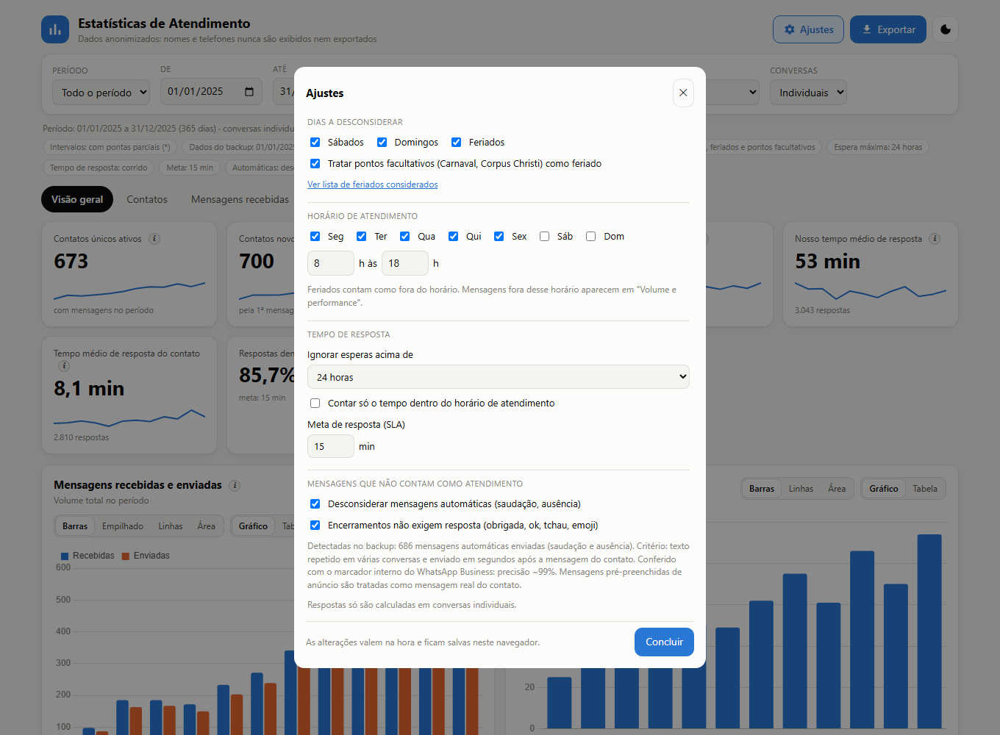

# 3. Ajustes e regras

O botão **Ajustes** (topo da página) abre uma janela com as regras que mudam os números. As alterações valem na hora e ficam
salvas no navegador. O resumo do que está valendo aparece sempre na linha de status. Cada regra tem a explicação completa em
`ajuda.html` (botão "i" → "Saiba mais").

## Dias a desconsiderar

Sábados, domingos e **feriados** (mais a opção de tratar **pontos facultativos** como feriado). Padrão: tudo marcado.

- Mensagens e ligações desses dias são ignoradas.
- **Contatos novos não são afetados**: um contato é novo na data real da primeira mensagem, mesmo que seja num dia desconsiderado.
- No tempo de resposta, o relógio não corre nesses dias, e uma resposta dada num dia desconsiderado não entra no cálculo.
- A lista de feriados (botão "Ver lista de feriados considerados") é a de **São Paulo (SP)**: feriados nacionais, a Revolução
  Constitucionalista (9 de julho, estadual) e o aniversário da cidade (25 de janeiro). Carnaval e Corpus Christi são pontos
  facultativos. Para outra cidade, edite `holidayList` em `stats/stats-core.js`.

## Horário de atendimento

Dias da semana e horas (padrão: segunda a sexta, 8 h às 18 h). Define o que é "fora do horário": outro dia da semana, antes ou depois da
janela, ou **feriado**. O mesmo horário vale para todos os dias.

## Tempo de resposta

- **Ignorar esperas acima de**: uma espera de dias costuma ser só um "até a próxima", não um atendimento lento. Padrão: 24 horas.
- **Contar só o tempo dentro do horário de atendimento**: noites, fins de semana e feriados deixam de pesar.
- **Meta de resposta (SLA)**: usada no indicador "Respostas dentro da meta" (padrão: 15 min).

A espera começa na primeira mensagem do contato ainda sem resposta (ou na nossa primeira mensagem sem resposta, no outro sentido)
e termina na mensagem seguinte do outro lado. Mensagens automáticas e encerramentos não contam.

## Mensagens automáticas

Saudação e mensagem de ausência enviadas pelo WhatsApp Business. Elas são detectadas por **texto repetido em várias conversas e enviado
em poucos segundos** após a mensagem do contato. Padrão: desconsideradas (não contam como mensagens, nem como resposta, nem definem
quem iniciou a conversa).

Em testes com os marcadores internos do WhatsApp Business, o critério acertou cerca de 99% das automáticas enviadas. Textos curtos
(menos de 12 caracteres) ou repetidos em poucas conversas não são detectados.

## Encerramentos

Mensagens que não pedem resposta: agradecimentos ("obrigada"), "ok", "combinado", despedidas ("tchau", "até amanhã"), votos
("tenha uma ótima semana"), figurinhas e mensagens só com emoji. Padrão: **não exigem resposta**. Elas não entram em "conversas sem
resposta" e não abrem uma espera de resposta.

É uma regra de texto, **não é exata**: mensagens com "?", saudações de abertura ("bom dia") e qualquer mensagem com outras palavras
("obrigada, vou pensar") continuam exigindo resposta.

## Conversas sem resposta

Contam só o que está parado há **mais de 24 horas** (as mais recentes aparecem à parte, como "recentes") e que não é um encerramento.
Respostas dadas por ligação ou por outro canal não aparecem no backup, então uma conversa resolvida assim ainda conta como sem resposta.

## Canal de origem dos contatos

O gráfico **"Contatos novos por canal de origem"** (aba Contatos) e os indicadores "Principal canal de origem" e "Origem identificada"
**só aparecem quando padrões de origem foram configurados** ao gerar o arquivo de estatísticas (opção `--origens`). Veja
[como configurar](../README.pt-BR.md#identificar-o-canal-de-origem-dos-contatos-opcional).

A detecção é feita na **primeira mensagem de texto recebida** de cada conversa individual (não grupos), comparando o conteúdo
normalizado (sem acentos, sem maiúsculas) com os termos configurados. Contatos que não mencionam a origem ficam em "Não identificado".

## Período fechado

Veja o capítulo [Usando o painel](02-usando-o-painel.md#comparação-e-intervalos-parciais).
